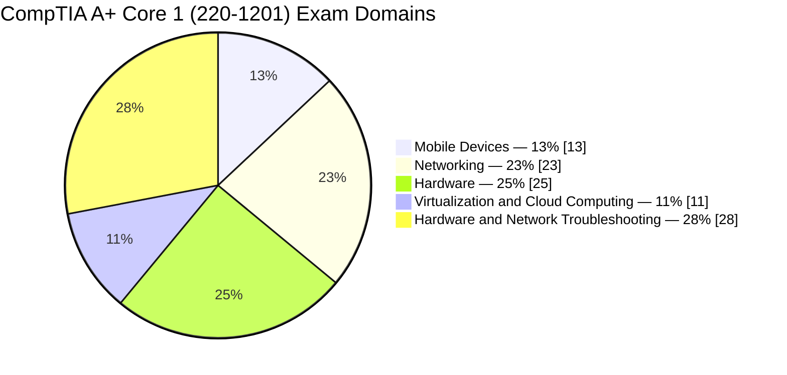
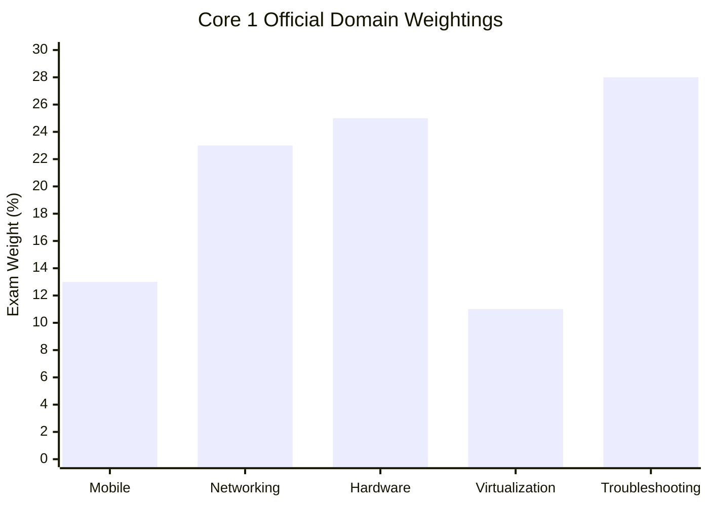
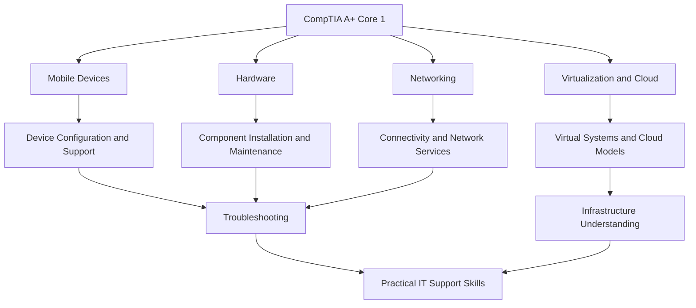
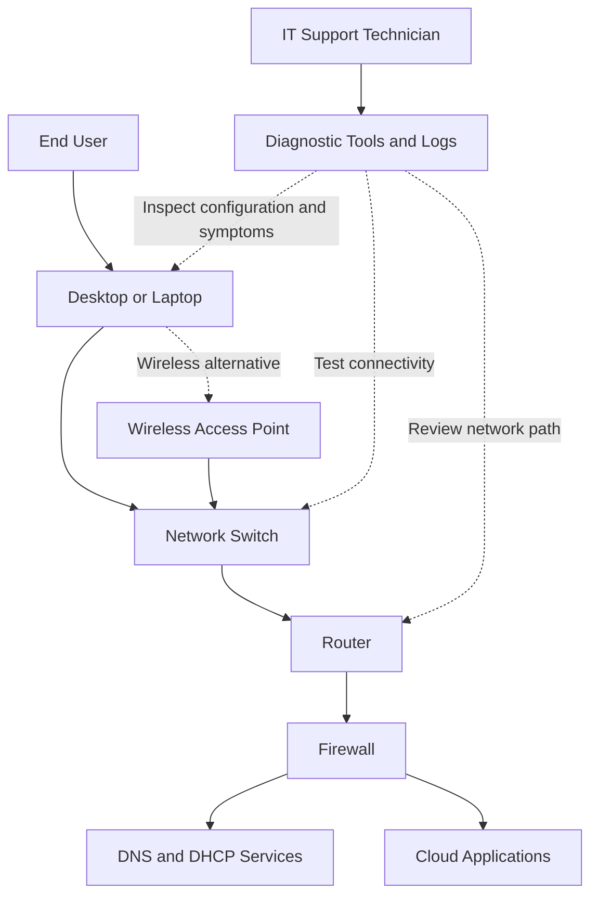
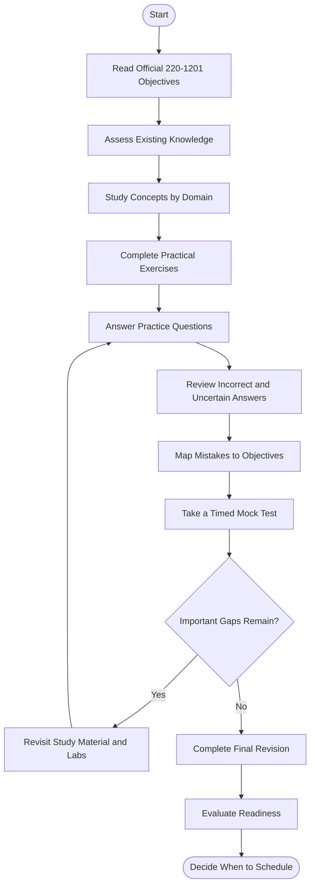
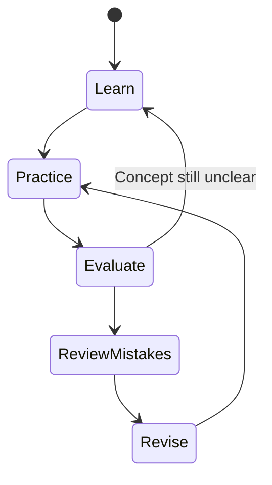
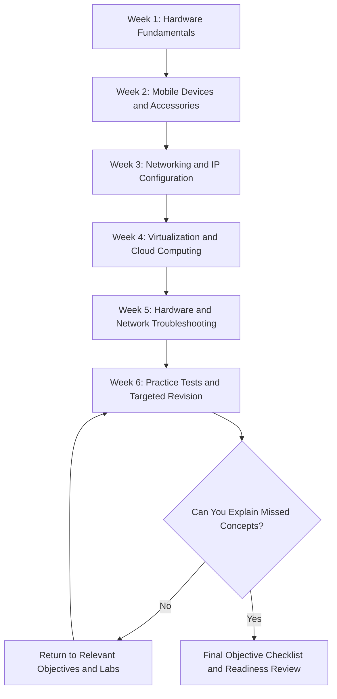
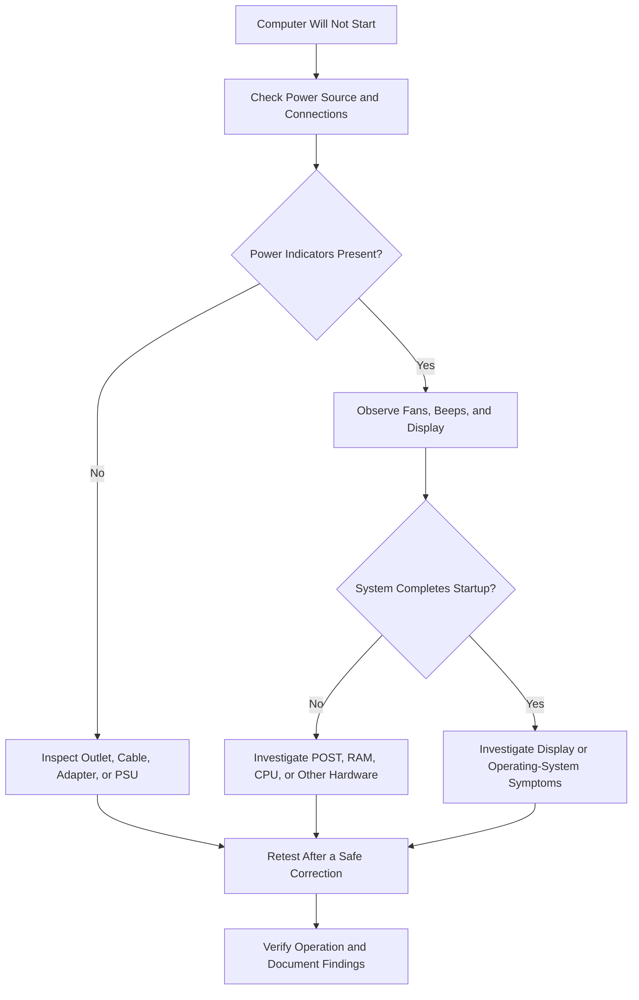
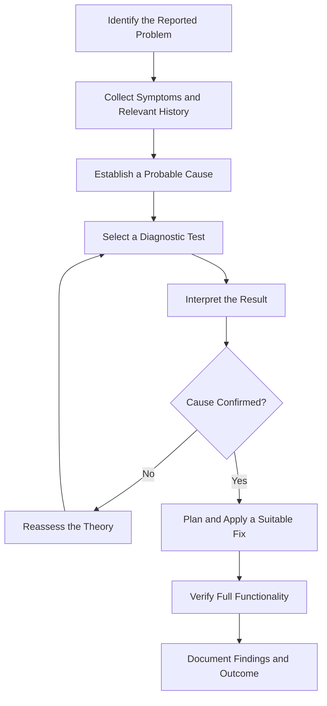

# CompTIA A+ Core 1 (220-1201) Study Guide

A practical study guide for the **CompTIA A+ Core 1 (220-1201) certification exam**. This repository helps learners organize their preparation around computer hardware, mobile devices, networking, virtualization, cloud computing, and hardware and network troubleshooting.

The goal is to build practical IT support knowledge, understand the official exam objectives, and learn how to diagnose technical problems instead of relying on memorized answers.

---

## Table of Contents

- [About CompTIA A+ Core 1](#about-comptia-a-core-1)
- [Who Should Use This Guide?](#who-should-use-this-guide)
- [Exam Overview](#exam-overview)
- [Official Exam Domains and Weightings](#official-exam-domains-and-weightings)
- [Core 1 Skills Map](#core-1-skills-map)
- [Technical Architecture: An IT Support Scenario](#technical-architecture-an-it-support-scenario)
- [Certification Preparation Flowchart](#certification-preparation-flowchart)
- [Continuous Study and Revision Cycle](#continuous-study-and-revision-cycle)
- [Step-by-Step Preparation Strategy](#step-by-step-preparation-strategy)
- [Suggested Six-Week Study Roadmap](#suggested-six-week-study-roadmap)
- [Hands-On Labs and Practical Projects](#hands-on-labs-and-practical-projects)
- [Practice Questions and Mock Tests](#practice-questions-and-mock-tests)
- [Common Preparation Mistakes](#common-preparation-mistakes)
- [Hardware and Network Troubleshooting Workflow](#hardware-and-network-troubleshooting-workflow)
- [Career Relevance](#career-relevance)
- [Frequently Asked Questions](#frequently-asked-questions)
- [Official and Additional Learning Resources](#official-and-additional-learning-resources)
- [About CertsGate](#about-certsgate)

---

## About CompTIA A+ Core 1

CompTIA A+ is an entry-level IT certification intended to validate foundational skills used in technical support and IT operations. Its Core 1 exam focuses on physical devices, hardware components, networking, virtualization, cloud computing, and troubleshooting.

The **220-1201 exam is associated with CompTIA A+ V15**. Its objectives emphasize practical knowledge that an IT support professional can use to install, configure, maintain, and troubleshoot end-user equipment.

For example, knowing the name of a storage device is only part of the job. A technician should also recognize symptoms of a failing drive, understand relevant interface types, choose an appropriate replacement, and verify that the computer works correctly afterward.

This guide combines objective-based learning with practical exercises, diagnostic scenarios, and original practice questions.

## Who Should Use This Guide?

This repository is suitable for:

- Beginners preparing for an entry-level IT support role.
- Help desk technicians strengthening their hardware knowledge.
- Computer repair learners who want a structured study plan.
- IT students learning networking, storage, mobile devices, and printers.
- Candidates preparing for CompTIA A+ Core 1 (220-1201).
- Existing technicians who want to review foundational hardware and troubleshooting concepts.

CompTIA recommends 12 months of hands-on experience in an IT support specialist role. This is recommended experience, not a requirement that every candidate must have identical work history.

If you are new to IT, begin with computer components, common connectors, operating principles, and basic networking before attempting complex troubleshooting scenarios.

## Exam Overview

| Exam Detail | Information |
|---|---|
| Certification | CompTIA A+ |
| Exam | Core 1 |
| Exam code | 220-1201 |
| Exam series | V15 |
| Maximum questions | 90 |
| Question types | Multiple-choice and performance-based |
| Duration | 90 minutes |
| Passing score | 675 on a scale of 100–900 |
| Recommended experience | 12 months of hands-on IT support experience |
| Official certification information | [CompTIA A+](https://www.comptia.org/en-us/certifications/a) |
| Official exam resources | [CompTIA Exam Objectives](https://www.comptia.org/en-us/resources/exam-objectives) |

Exam details and availability can change. Check the current official exam documentation before scheduling.

## Official Exam Domains and Weightings

The official Core 1 blueprint divides the exam into five domains. Use the published weights to allocate study time, while giving additional attention to subjects where your understanding is weak.

| Official Domain | Exam Weight |
|---|---:|
| 1.0 Mobile Devices | 13% |
| 2.0 Networking | 23% |
| 3.0 Hardware | 25% |
| 4.0 Virtualization and Cloud Computing | 11% |
| 5.0 Hardware and Network Troubleshooting | 28% |
| **Total** | **100%** |

### Official Domain Weight Distribution

### Compare the Domain Weights

The two largest domains are Hardware and Hardware and Network Troubleshooting. Together, they represent 53% of the published exam weighting. That makes component identification, failure symptoms, diagnostic tools, and repair decisions important priorities.

Do not completely skip the smaller domains. Virtualization and cloud computing, for example, are useful topics to study alongside hardware and support fundamentals.

## What Each Exam Domain Covers

### 1.0 Mobile Devices — 13%

Focus on the components and support requirements of laptops, smartphones, and other mobile devices.

Key study areas include:

- Laptop hardware and component replacement.
- Displays, batteries, keyboards, memory, and storage.
- Docking stations, adapters, and accessories.
- USB-C and other connectivity options.
- Wireless connectivity and mobile device configuration.
- Common mobile device symptoms and appropriate support actions.

**Practical goal:** Be able to identify a likely component issue, choose a suitable replacement or accessory, and explain how to verify the result.

### 2.0 Networking — 23%

Learn how computers and devices communicate across local networks and the internet.

Important topics include:

- Common TCP and UDP ports and protocols.
- Wireless standards, frequency bands, and channel selection.
- DNS, DHCP, web servers, file services, and other network services.
- Routers, switches, access points, firewalls, and network adapters.
- IPv4 and IPv6 addressing.
- Private and public addresses, subnet masks, and default gateways.
- SOHO network configuration.
- Wired and wireless connection types.
- Basic network diagnostic tools.

**Practical goal:** Explain the path from a client device to a network service and recognize configuration errors that can prevent communication.

### 3.0 Hardware — 25%

Understand the components inside computers, their functions, compatibility requirements, and common installation considerations.

Study:

- Motherboards and expansion slots.
- CPUs, RAM, and cooling.
- Storage technologies and interfaces.
- Power supplies and power protection.
- Displays and connectors.
- Printers and peripheral devices.
- Cables, adapters, and common connectors.
- Component selection, installation, and maintenance.

**Practical goal:** Identify components, compare their functions, recognize compatibility concerns, and choose suitable parts for a given requirement.

### 4.0 Virtualization and Cloud Computing — 11%

Learn the purpose of virtualization and the basic characteristics of cloud computing.

Key topics include:

- Virtual machines and hypervisors.
- Virtualization use cases.
- Containers and their general purpose.
- Cloud service models such as IaaS, PaaS, and SaaS.
- Cloud deployment models.
- Resource scalability and shared infrastructure.

**Practical goal:** Distinguish a virtual machine from a physical computer and select an appropriate cloud or virtualization approach for a simple scenario.

### 5.0 Hardware and Network Troubleshooting — 28%

Develop a methodical approach to diagnosing common hardware and connectivity problems.

Focus on:

- Motherboard, RAM, CPU, and power symptoms.
- Storage failures and RAID-related issues.
- Display and projector problems.
- Mobile device faults.
- Network connectivity and performance issues.
- Printer symptoms and maintenance.
- Selecting diagnostic tools.
- Verifying repairs and documenting findings.

**Practical goal:** Connect symptoms with likely causes, select an appropriate test, interpret the result, and verify the repair rather than changing parts without evidence.

---

## Core 1 Skills Map

The following is an independent learning map that groups related skills. It is not an additional official exam blueprint.

The subjects overlap in real support work. A laptop issue may involve hardware, wireless networking, and troubleshooting at the same time. Practice connecting concepts instead of studying every topic in isolation.

## Technical Architecture: An IT Support Scenario

This illustrative diagram shows a typical small-office endpoint and support environment. It is a conceptual example, not an official CompTIA diagram.

### How to Apply This Diagram

If a user cannot access a cloud application:

1. Check whether the device powers on and connects to the network.
2. Inspect the IP address, subnet mask, default gateway, and DNS settings.
3. Test local connectivity.
4. Check whether name resolution works.
5. Investigate the network path and any relevant filtering.
6. Test the application and review available error messages.
7. Document the findings and verify the outcome after any repair.

This is a starting point, not a universal troubleshooting sequence. The best next step depends on the observed symptoms.

## Certification Preparation Flowchart

Use this flowchart to structure preparation from the first review to the final readiness check.

The purpose of the loop is to turn practice results into a targeted study plan. Repeating questions without understanding the reasoning behind them is much less useful than correcting the underlying knowledge gap.

## Continuous Study and Revision Cycle

Use this cycle throughout preparation. For example, if a networking question reveals confusion about DHCP and DNS, revisit those concepts, complete a small exercise, and then answer a new scenario that tests the same distinction.

## Step-by-Step Preparation Strategy

### Step 1: Review the Official Objectives

Download the current Core 1 objectives from CompTIA. Use the objective headings as a checklist and identify what you already know.

For every objective, record whether you have studied it, practiced it, and can explain it without looking at notes.

### Step 2: Learn Hardware Fundamentals

Study component functions, common connectors, storage technologies, RAM, CPUs, cooling, and power supplies.

Use diagrams or physical components where possible. Learn not only the names but also the symptoms associated with common failures.

### Step 3: Strengthen Networking Knowledge

Review common ports, protocols, wireless technologies, network devices, IP configuration, and network services.

Practice reading IP settings and diagnosing basic connectivity problems. Be able to explain what DNS, DHCP, a default gateway, and a subnet mask do.

### Step 4: Understand Mobile Devices and Cloud Concepts

Compare laptop components and accessories. Learn how docking stations and connectivity options support different work environments.

For virtualization and cloud computing, understand the role of a hypervisor, the difference between virtual and physical machines, and the basic cloud service models.

### Step 5: Practice Troubleshooting

For every scenario, ask:

- What exactly is failing?
- What evidence do I have?
- What is the most likely cause?
- Which test would help confirm or eliminate that cause?
- What solution is appropriate?
- How will I verify that the problem is resolved?

Avoid immediately replacing components without testing.

### Step 6: Use Practice Questions as a Diagnostic Tool

Answer questions after studying the related concepts. Review incorrect answers and correct answers that required guessing.

For supplementary practice, [CertsGate's CompTIA A+ 220-1201 page](https://certsgate.com/exams/comptia/220-1201) can be used alongside official objectives and hands-on exercises.

### Step 7: Revisit Weak Areas

Use practice results to select your next study topic. If you repeatedly miss storage or RAID questions, revisit the underlying concepts and practice interpreting symptoms before attempting another mixed test.

### Step 8: Check Readiness

Use a timed mock test to practice pacing. Then review the questions you missed or guessed on and confirm that you can explain the relevant concepts and apply them in a fresh scenario.

A practice score is one indicator of readiness, not a guarantee of an exam result.

---

## Suggested Six-Week Study Roadmap

This is an independent suggested schedule, not an official CompTIA preparation plan. Adjust it to your experience and available time.

| Week | Focus | Practical Target |
|---|---|---|
| 1 | Computer hardware | Identify components and explain their functions |
| 2 | Mobile devices | Compare components, accessories, and connectivity options |
| 3 | Networking | Read IP configurations and diagnose basic connectivity issues |
| 4 | Virtualization and cloud | Explain hypervisors, virtual machines, and cloud models |
| 5 | Troubleshooting | Work through hardware, network, display, and printer scenarios |
| 6 | Mixed practice and revision | Review errors, repeat weak-area exercises, and complete a readiness check |

If you need longer to master a topic, extend the schedule. Understanding the material matters more than completing the plan on a fixed date.

## Hands-On Labs and Practical Projects

Hands-on work is especially valuable for Core 1 because it connects technical terminology with the devices and symptoms encountered in IT support.

Use a personal device, an authorized lab, or a suitable simulator. Follow electrostatic discharge precautions and disconnect power before handling internal components when appropriate.

| Lab | Activity | Learning Outcome |
|---|---|---|
| Component identification | Identify RAM, storage, CPU cooling, motherboard connectors, and power connections | Understand component functions and locations |
| Storage comparison | Compare HDDs and SSDs and inspect available storage interfaces | Recognize differences in performance and connectivity |
| Peripheral setup | Connect a display, USB accessory, or docking station | Diagnose compatibility and connection issues |
| Mobile-device support | Inspect accessories, wireless settings, and device connectivity | Understand common mobile support tasks |
| IP configuration | Inspect IP address, subnet mask, gateway, and DNS settings | Recognize common configuration errors |
| Network testing | Use `ping`, `tracert` or `traceroute`, and DNS lookup tools | Interpret connectivity and name-resolution results |
| Wireless analysis | Inspect signal strength and available channels with an appropriate tool | Recognize potential wireless interference |
| Virtual machine setup | Create or inspect a VM in an authorized environment | Understand basic virtualization concepts |
| Printer troubleshooting | Investigate connectivity, paper handling, print quality, and queue symptoms | Match symptoms to likely causes |
| Repair documentation | Write a short ticket describing symptoms, tests, findings, and resolution | Practice professional support documentation |

### Example: Diagnose a Computer That Will Not Start

This is a simplified educational decision tree. Follow manufacturer service guidance and use appropriate safety precautions before performing hardware diagnostics.

---

## Practice Questions and Mock Tests

Practice questions are most effective when they test understanding rather than recall of answer patterns.

Use the following review process:

**Answer → Review → Understand → Identify Weak Area → Revisit Material → Try Again**

Supplementary practice material is available through [CertsGate CompTIA A+ 220-1201 preparation](https://certsgate.com/exams/comptia/220-1201). Use it to complement official objectives, technical learning resources, and practical exercises.

### Original Sample Practice Questions

These questions are original examples written for this repository. They are not official CompTIA questions and are not intended to reproduce live exam content.

#### Question 1: Networking

A computer can communicate with devices on its local network but cannot reach destinations outside the local network. Which setting should be checked early in the investigation?

A. Screen resolution  
B. Default gateway  
C. Printer toner level  
D. CPU fan speed

**Answer: B — Default gateway.**

The default gateway provides a route to destinations outside the local subnet. Check the IP configuration and routing path before concluding that the gateway is the cause.

#### Question 2: Hardware

A desktop computer powers on, but the monitor displays no image. What is a sensible initial check?

A. Replace the CPU immediately  
B. Verify the display's power, input selection, and cable connections  
C. Reinstall every application  
D. Change the DNS server

**Answer: B — Verify the display connections.**

Start with simple, observable causes before replacing components. If the display connections are correct, continue with systematic diagnosis.

#### Question 3: Cloud Computing

Which cloud service model generally provides customers with a platform for deploying applications without managing the underlying physical infrastructure?

A. PaaS  
B. SaaS  
C. Local-only computing  
D. Bare-metal hardware ownership

**Answer: A — PaaS.**

Platform as a Service provides an application development and deployment platform while the provider manages the underlying infrastructure.

#### Question 4: Mobile Devices

A laptop user wants to connect to multiple external peripherals through one docking station. What should you verify before recommending a dock?

A. Only the laptop's screen brightness  
B. Compatibility with the laptop and the required ports and features  
C. The printer's paper capacity  
D. The cloud provider's service model

**Answer: B — Compatibility with the laptop.**

Check the laptop's supported connection, the dock's features, power requirements, and the peripherals the user needs.

#### Question 5: Troubleshooting

A network printer is powered on, but a workstation cannot print. What should you investigate before replacing the printer?

A. The workstation's connection, printer selection, and print queue  
B. The workstation's screen resolution  
C. The CPU's clock speed  
D. The laptop's battery health

**Answer: A — Check connectivity and the print queue.**

Verify the selected printer, network reachability, queue status, and any reported errors before considering hardware replacement.

### How to Review Practice Results

For each question, record:

- Which official domain it relates to.
- Why the correct answer is appropriate.
- Why the alternatives are less suitable.
- Whether you guessed or misunderstood the scenario.
- Which concept or practical exercise would address the gap.

When taking mock tests, review both incorrect answers and uncertain correct answers. Do not confuse familiarity with a repeated question bank with the ability to solve new problems.

---

## Common Preparation Mistakes

### Memorizing Components Without Learning Their Functions

Know what components do and how their failure can affect a computer. Understanding symptoms makes it easier to select an appropriate diagnostic step.

### Ignoring Networking Basics

IP addressing, DNS, DHCP, gateways, ports, and common network devices are essential support knowledge. Practice explaining how they work together.

### Skipping Hands-On Work

Reading about RAM installation or wireless troubleshooting is not the same as performing or simulating the task. Include practical exercises in your routine.

### Treating Every Symptom as a Hardware Failure

A blank display, slow computer, or failed connection can have several causes. Check simple settings and connections before replacing parts.

### Neglecting Virtualization and Cloud Computing

Although this domain has the smallest published weight, it is still part of the exam objectives. Understand the core concepts rather than skipping it.

### Using Outdated Exam Materials

Check that your resources match the current 220-1201 objectives. Older Core 1 exams can contain useful fundamentals, but their coverage may differ.

### Repeating Questions Without Reviewing Mistakes

A high score on familiar questions can create false confidence. Review the reasoning and test the same concept using a different scenario.

### Rushing the Final Revision

Reserve time to revisit weak objectives, practice troubleshooting, and confirm that you can explain answers without relying on notes.

---

## Hardware and Network Troubleshooting Workflow

A consistent process helps prevent unnecessary changes and component replacement.

### Diagnostic Tools to Recognize

| Tool | Common Purpose |
|---|---|
| Multimeter | Measure electrical properties such as voltage and continuity where appropriate |
| Cable tester | Check network cable wiring and continuity |
| Loopback adapter | Help test a port or interface by returning transmitted signals |
| Wi-Fi analyzer | Inspect wireless networks, channels, and signal conditions |
| `ping` | Test IP reachability and observe response times or packet loss |
| `tracert` / `traceroute` | Examine the path toward a destination |
| `ipconfig` / `ifconfig` / `ip` | Inspect network configuration, depending on the operating system |
| `nslookup` / `dig` | Query DNS information |
| Task and system monitoring tools | Inspect resource usage and identify possible performance bottlenecks |

Tools provide evidence, not automatic diagnoses. Interpret results in context and verify any proposed fix.

## Career Relevance

CompTIA A+ Core 1 supports foundational knowledge used in roles such as:

- Help desk technician.
- IT support specialist.
- Desktop support technician.
- Computer repair technician.
- Junior IT operations technician.
- Technical support analyst.

Core 1 can also provide a foundation for further learning in networking and infrastructure. Certification alone does not guarantee employment; practical experience, communication, documentation, and continued learning remain important.

---

## Frequently Asked Questions

### What is CompTIA A+ Core 1 (220-1201)?

It is the Core 1 exam in the CompTIA A+ V15 series. It covers mobile devices, networking, hardware, virtualization and cloud computing, and hardware and network troubleshooting.

### How many questions are on the 220-1201 exam?

The published maximum is 90 questions. The exam includes multiple-choice and performance-based questions.

### How long is the Core 1 exam?

The published duration is 90 minutes. Confirm current details with CompTIA before scheduling.

### What is the passing score for 220-1201?

The published passing score is 675 on a scale of 100–900.

### Is Core 1 alone enough to earn CompTIA A+?

No. CompTIA A+ requires passing both Core 1 (220-1201) and Core 2 (220-1202) from the applicable exam series. Check the official certification page for current requirements.

### Which Core 1 domain deserves the most attention?

Hardware and Network Troubleshooting has the largest published weighting at 28%, followed by Hardware at 25%. Use these weights to plan study time, but prioritize your personal knowledge gaps as well.

### Are practice questions enough to prepare?

No single practice resource is sufficient for every learner. Combine the official objectives, concept study, hands-on exercises, practice questions, and careful review of mistakes.

### Where can I find supplementary study material?

Begin with CompTIA's official objectives and certification resources. You can also explore [CertsGate's 220-1201 preparation page](https://certsgate.com/exams/comptia/220-1201) for independent supplementary material.

---

## Official and Additional Learning Resources

Use official CompTIA resources to confirm certification requirements and exam coverage. Additional resources can help explain concepts and provide practical experience.

### Official CompTIA Resources

- [CompTIA A+ Certification](https://www.comptia.org/en-us/certifications/a) — official certification information.
- [CompTIA Exam Objectives](https://www.comptia.org/en-us/resources/exam-objectives) — locate the current Core 1 objectives and other exam documentation.
- [CompTIA Exam Policies](https://www.comptia.org/en-us/resources/test-policies) — review current testing policies.
- [CompTIA Training](https://www.comptia.org/en-us/training) — explore available learning options.

### Additional Technical Resources

- [Cisco Networking Academy](https://www.netacad.com/) — networking education and learning opportunities.
- [Wireshark Documentation](https://www.wireshark.org/docs/) — packet analysis references and user documentation.
- [Microsoft Learn](https://learn.microsoft.com/) — technical documentation relevant to supported Microsoft products and services.
- [CertsGate: CompTIA A+ 220-1201](https://certsgate.com/exams/comptia/220-1201) — independent supplementary exam preparation material.

Check the current official exam objectives before relying on third-party study guides. Technical references may explain useful material that is not specifically required by the exam.

## About CertsGate

[CertsGate](https://certsgate.com/) provides independent IT certification preparation resources. Its exam-focused materials can supplement official documentation, technical study, and practical exercises.

For Core 1 candidates, supplementary practice can help review hardware, mobile devices, networking, virtualization, cloud computing, and troubleshooting concepts. Use practice questions to find gaps, then return to the relevant objectives and study material to strengthen your understanding.
